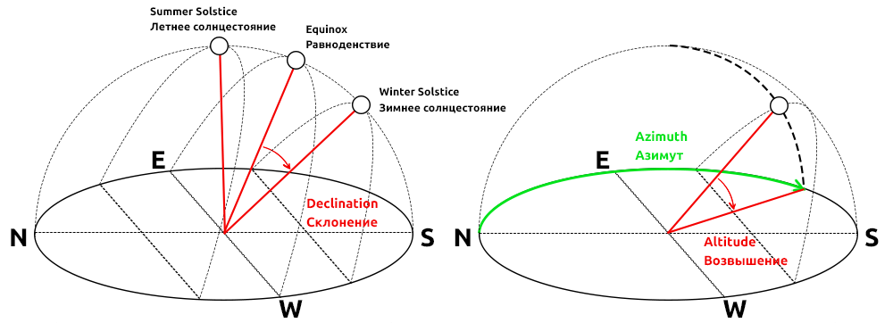

This is an automatic translation and may be incorrect in some places. See the source README and examples for authoritative information.

[](https://github.com/GyverLibs/SunPosition/releases/latest/download/SunPosition.zip)
[](https://registry.platformio.org/libraries/gyverlibs/SunPosition)
[](https://alexgyver.ru/)
[](https://alexgyver.ru/support_alex/)
[](https://github-com.translate.goog/GyverLibs/SunPosition?_x_tr_sl=ru&_x_tr_tl=en)  

[](https://t.me/GyverLibs)

# SunPosition
Library for determining the position of the sun by geolocation and time
- Takes latitude, longitude and unix time
- Gives out the angle of azimuth, the angle of elevation and declination of the sun

### Compatibility
Compatible with all Arduino platforms (Arduino features are used)

## Contents
- [Installation](#install)
- [Initialization](#init)
- [Use of use](#usage)
- [Example](#example)
- [Versions](#versions)
- [Bugs and feedback](#feedback)

<a id="install"></a>
## Installation
- The library can be found under the name **SunPosition** and installed through the library manager in:
    - Arduino IDE
    - Arduino IDE v2
    - PlatformIO
- [Download the library](https://github.com/GyverLibs/SunPosition/archive/refs/heads/main.zip).zip archive for manual installation:
    - Unpack and put in *C:\Program Files (x86)\Arduino\libraries* (Windows x64)
    - Unpack and put in *C:\Program Files\Arduino\libraries* (Windows x32)
    - Unpack and put in *Documents/Arduino/libraries/ *
    - (Arduino IDE) Automatic installation from .zip: *Sketch/Connect library/Add .ZIP library...* and specify downloaded archive
- Read more detailed instructions for installing libraries[here](https://alexgyver.ru/arduino-first/#%D0%A3%D1%81%D1%82%D0%B0%D0%BD%D0%BE%D0%B2%D0%BA%D0%B0_%D0%B1%D0%B8%D0%B1%D0%BB%D0%B8%D0%BE%D1%82%D0%B5%D0%BA)
### Update
- I recommend always updating the library: new versions fix errors and bugs, as well as optimize and add new features.
- Through the library manager IDE: find the library as when installing and click "Update"
- Manually: **Delete the folder with the old version** and then put the new one in its place. “Replacement” can not be done: sometimes new versions delete files that will remain when replaced and can lead to errors!

<a id="init"></a>
## Initialization
```cpp
// initialize
SunPosition pos;

// specify latitude (degrees), longitude (degrees), unix time (seconds), the calculation will be performed
SunPosition(latitude, longitude, unix);
SunPosition(latitude, longitude, unix, gmt);    // + time zone in hours or minutes
```

<a id="usage"></a>
## Use of use
```cpp
// perform the calculation, specify latitude (degrees), longitude (degrees), unix time (seconds)
void compute(float latitude, float longitude, uint32_t unix);

// calculate, specify latitude (degrees), longitude (degrees), unix time (seconds), time zone in hours or minutes
void compute(float latitude, float longitude, uint32_t unix, int16_t gmt);

int sunrise();          // Time of dawn, minutes from the beginning of the day by local time
int noon();             // noon, minutes from the beginning of the day local time
int sunset();           // Sunset time, minutes from the beginning of the day by local time
int daylight();         // daylight duration, in minutes
float altitude();       // elevation
float declination();    // declination
float zenith();         // zenith
float azimuth();        // azimuth of the sun, clockwise north
int azimuthMin();       // dawn
int azimuthMax();       // sunset
int angle180();         // azimuth, scaled in the range of 0-180 degrees to rotate the solar panel (summer 0.180, winter 50). 130)
int angle90();          // azimuth, scaled in the range of -90..90 degrees to rotate the solar panel (in summer -90..90, in winter -20..). 20)
```

- The latitude and longitude of the place can be taken from any maps (Yandex, Google).
- Unix time can be taken from any real-time source (RTC, NTP) and converted from date and time using the library.[UnixTime](https://github.com/GyverLibs/UnixTime)

  
- **The angle of declination** - the angle from the direction of the sun at the equinox, varies throughout the year. The angle of the equinox is`90 - широта`
- **Azimuth** - horizontal direction of the sun, counted from clockwise direction north
- **Elevation ** - direction of the sun vertically from the horizon

<a id="example"></a>
## Example
```cpp
#include <SunPosition.h>

void setup() {
  Serial.begin(9600);
  SunPosition sun(55.75, 37.62, 1658325600);
  //sun.compute(55.75, 37.62, 1658325600);
  Serial.println(sun.altitude());
  Serial.println(sun.azimuth());
  Serial.println(sun.declination());
}

void loop() {
}
```

<a id="versions"></a>
## Versions
- v1.0
- v1.1 - completely rewritten equations, added time and sunset/dawn azimuth and other useful angles (see dock)

<a id="feedback"></a>
## Bugs and feedback
If you find bugs, create **Issue**, or better write to the mail immediately.[alex@alexgyver.ru](mailto:alex@alexgyver.ru)  
The library is open for revision and your **Pull Requests*!

When reporting bugs or incorrect work of the library, it is necessary to specify:
- Library version
- What is used by the IC
- SDK version (for ESP)
- Arduino IDE version
- Are embedded examples that use features and designs that cause bugs in your code working correctly?
- What code was downloaded, what work was expected from it and how it works in reality
- Ideally, attach the minimum code in which the bug is observed. Not a canvas of a thousand lines, but a minimum code.
